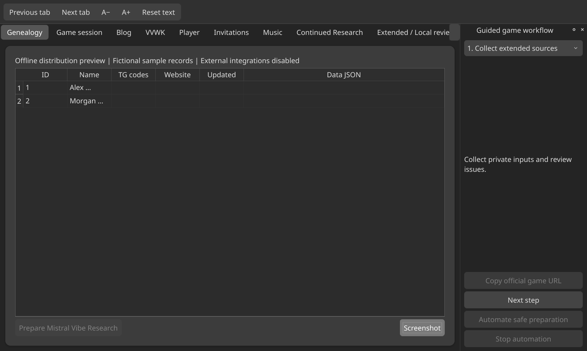

# AncesTale-final 0.7.9 — offline preview

An experimental Qt/C++ desktop interface for AI-assisted genealogy and historical storytelling. This preview displays fictional sample records and retains the original workflow panels. External integrations are disabled; signing, live multiplayer, voice, media, server deployment and AI automation are not included as working public features.

## Build

Requires CMake 3.21+, C++17, Qt 6 Widgets, Network and Multimedia, and OpenSSL Crypto. Use an in-source-tree build directory (not the source root):

```sh
cmake -S . -B build/preview
cmake --build build/preview --parallel 2
./build/preview/AncesTale-final
```

This is a development preview, not yet a relocatable store package. Some inactive integration code retains development paths; do not enable these integrations. No private genealogy database, credentials, media, signing keys or server scripts are distributed in this preview.

## License

Copyright (c) 2026 Jeremiah O'Neal.

Original source in this release is licensed under the
GNU General Public License version 3 (GPL-3.0-only),
subject to applicable third-party notices.

Previous licensing milestones remain available:

- v0.7.9-mit: MIT License
- v0.7.9-apache2: Apache License 2.0

Previous license documents and copyright notices
are preserved in the LICENSES directory.

Qt, OpenSSL and multimedia dependencies retain
their own licenses. No dependency binaries are included.

The preview screenshot is provided separately as documentation.

## Screenshot


